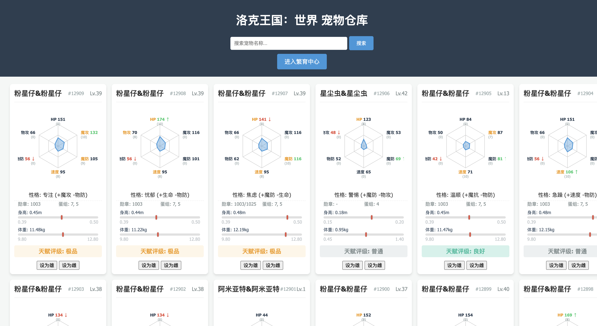
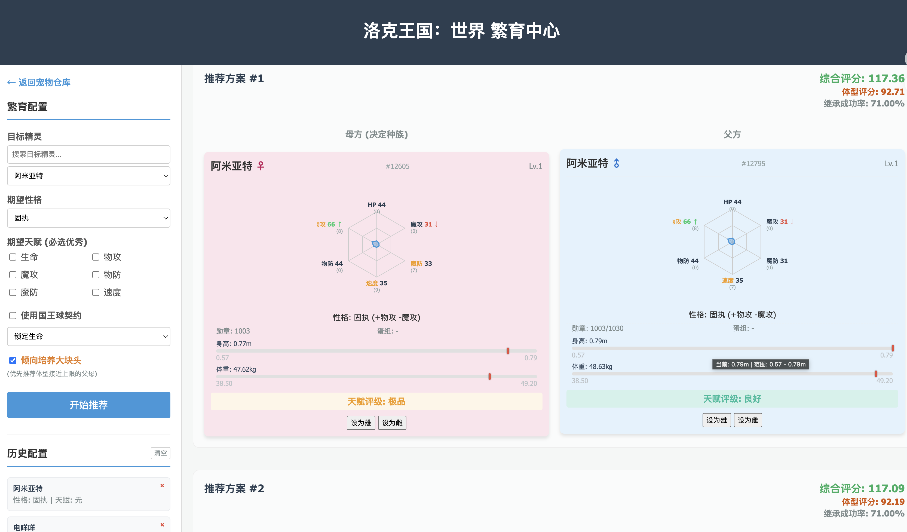
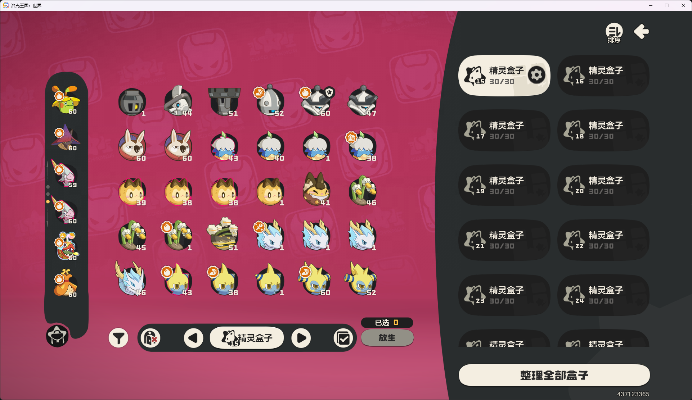
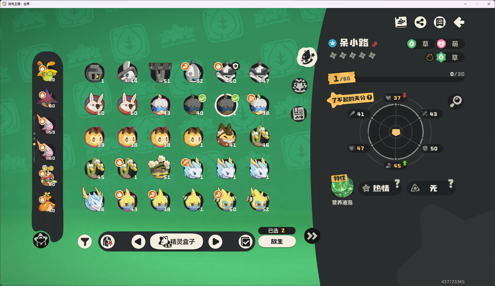
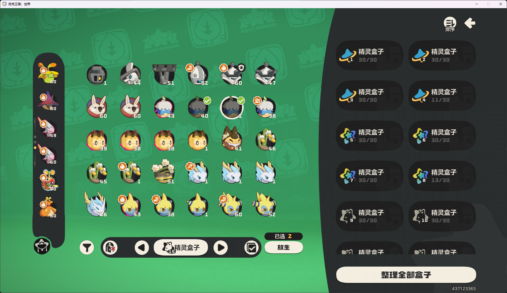

# 洛克王国：世界 宠物仓库


本地工具，用来看自己的精灵仓库、挑繁育父母、算放生建议。数据在本机 SQLite 里。

## 核心功能

- **仓库**：按盒子 6×5 查看，空格子留在原位。可标大世界队伍、隐藏异色/炫彩。
- **繁育**：按蛋组和遗传权重推荐父母，可偏向体型和指定性格。
- **放生**：按进化家族保留异色/炫彩、慈悲为怀、同乘、爱分享、疾行和评分靠前的个体。
- **抓包记录**：管理员身份下把本机游戏的 8195 连接改道到本地观察，解密后写入仓库。换盒、进化、孵蛋、捕捉会在当前会话里更新；登录盒子快照认不全时，不会清掉没看到的格子。
- **同步精灵**：用 `.env` 里的令牌走游戏 HTTP 接口。不写盒子位置。大世界队伍不会因为不在这份名单里被标成已放生。

## 📸 界面预览 (Screenshots)

| 个人仓库 | 繁育推荐 |
| :---: | :---: |
|  |  |

游戏里的精灵盒子是 6×5。点击放生对着这个画面校准，并且会按盒子编号差几次「下一盒」，不会在隔了一个盒子时仍按下一盒的格子去点。

| 勾选放生 | 盒子列表 | 当前盒子 |
| :---: | :---: | :---: |
|  |  |  |

默认只监听 `127.0.0.1:8000`。要用环境变量改成对远程开放，见下面的 [部署到 Ubuntu](#部署到-ubuntu)。修改数据的请求要带启动时写到 `captures/api.token` 的令牌，页面会自己带上。

## 🛠️ 技术栈

- **后端**: Python 3.12+, FastAPI, SQLite
- **前端**: 原生 JS、HTML、CSS
- **依赖**: `uv`（`pyproject.toml` / `uv.lock`）

## 🚀 快速开始

### 1. 克隆项目
```bash
git clone https://github.com/AlbertLighter/roco-kingdom-world-pet-warehouse.git
cd roco-kingdom-world-pet-warehouse
git submodule update --init
```

### 2. 安装依赖
```bash
uv sync
```

抓包还需要可选依赖，并且进程要有管理员权限：

```bash
uv sync --extra capture
```

Windows 上可以直接运行项目根目录的 `start.bat`。它会申请管理员权限，再执行 `uv run python backend/main.py`。

### 3. 令牌（只给「同步精灵」用）

复制 `.env.example` 为 `.env`，填入自己的令牌。不要把 `.env` 提交出去。已经有 `warehouse.db` 时，打开网页不必配置令牌。

### 4. 启动
在项目根目录执行：

```bash
uv run python backend/main.py
```

浏览器打开 [http://localhost:8000](http://localhost:8000)。四个页面是仓库、繁育中心、放生推荐、抓包记录。

不设置 `ROCO_HOST` / `ROCO_PORT`（或 `HOST` / `PORT`）时，仍是 `127.0.0.1:8000`。静态页从项目里的 `frontend/` 读取，不依赖当前工作目录，也不依赖 Windows 路径。

改了抓包、解密或前端代码后，需要重启这个进程。抓包记录要先点「改道记录」，再进入游戏。

### OCR 自动补全性别

启动本项目后，`roco-warehouse-ocr` 可以把识别到的六维和性别发送到
`POST /api/match_gender_by_stats`。接口只匹配 `is_active=1` 的精灵，并且仅在六维
`hp / adAttack / adDefense / apAttack / apDefense / speed` 全部相同、结果恰好一条、
该条 `gender=0` 时设置性别。无匹配、重复六维或已有性别都不会修改数据库。

## 📂 项目结构

- `backend/main.py`：HTTP 接口。
- `frontend/`：仓库、繁育、放生、抓包四个页面。
- `scripts/`：HTTP 同步、改道解密、盒子与队伍、放生点击、对照窗。
- `docs/`：字段、繁育和放生规则、接口说明。
- `deploy/`：Ubuntu 的 systemd 单元，以及可选的 nginx 反代。
- `roco_kingdom_world_conf/`：游戏配置子模块，只读。

## 部署到 Ubuntu

远程 Linux 用来浏览仓库、繁育和放生，以及用 `.env` 里的令牌做 HTTP 同步。WinDivert 改道抓包、点击放生和盒子对照窗是 Windows 功能，服务器上不要执行 `uv sync --extra capture`。本机 Windows 继续用 `start.bat`，不用改监听地址。

下面假设代码放在 `/opt/roco-kingdom-world-pet-warehouse`。腾讯云上的 docker 和 nginx 可以继续留给别的服务；这个仓库用 systemd 和 `uv` 创建的虚拟环境即可。

### 1. 安装 uv 并拉取代码

```bash
curl -LsSf https://astral.sh/uv/install.sh | sh
sudo mkdir -p /opt/roco-kingdom-world-pet-warehouse
sudo chown "$USER" /opt/roco-kingdom-world-pet-warehouse
git clone https://github.com/AlbertLighter/roco-kingdom-world-pet-warehouse.git /opt/roco-kingdom-world-pet-warehouse
cd /opt/roco-kingdom-world-pet-warehouse
git submodule update --init
uv python install 3.12
uv sync
```

`uv sync` 只装浏览和 HTTP 同步需要的依赖。`pydivert` 在可选的 `capture` 里，Linux 上装不上，也不需要。

### 2. 环境文件

```bash
cp .env.example .env
```

编辑 `.env`，不要提交它。游戏令牌只给「同步精灵」用；已有 `warehouse.db` 时可以把它拷到项目根目录再浏览。监听示例：

```bash
# 推荐：进程只听本机，由 nginx 对外
ROCO_HOST=127.0.0.1
ROCO_PORT=8000

# 不用反代、直接对网卡开放时再改。安全组只放行自己的 IP。
# ROCO_HOST=0.0.0.0

# 页面和接口不同源时才需要。逗号分隔，不要写 *
# ROCO_CORS_ORIGINS=https://warehouse.example.com
```

`ROCO_HOST` / `ROCO_PORT` 优先于 `HOST` / `PORT`。都不写时仍是 `127.0.0.1:8000`。

修改数据的接口仍然要带启动时写入 `captures/api.token` 的令牌。页面会先请求 `GET /api/token`。能连上这个服务的人也能读到令牌，所以不要把端口直接暴露到公网。

### 3. systemd

示例单元在 `deploy/roco-warehouse.service`。把里面的 `User`、`Group` 和 `/opt/roco-kingdom-world-pet-warehouse` 改成实际值后：

```bash
sudo cp deploy/roco-warehouse.service /etc/systemd/system/roco-warehouse.service
sudo systemctl daemon-reload
sudo systemctl enable --now roco-warehouse
sudo systemctl status roco-warehouse
```

日志里如果出现「监听在非本机地址」，说明 `ROCO_HOST` 不是回环地址。WinDivert 那条提示可以忽略，那是 Windows 抓包。

### 4. 可选：nginx

机器上已经有 nginx 时，用 `deploy/nginx-roco-warehouse.conf` 把域名反代到 `127.0.0.1:8000`。同步进度是 SSE，示例里关了代理缓冲。应用保持只听本机，安全组开放 80（以及你自己的 443），不要开放 8000。有的镜像没有 `sites-available`，这时把文件放到 `/etc/nginx/conf.d/roco-warehouse.conf`。

```bash
sudo cp deploy/nginx-roco-warehouse.conf /etc/nginx/sites-available/roco-warehouse.conf
sudo ln -s /etc/nginx/sites-available/roco-warehouse.conf /etc/nginx/sites-enabled/
sudo nginx -t && sudo systemctl reload nginx
```

同一域名打开页面时，浏览器请求是同源的，不用设置 `ROCO_CORS_ORIGINS`。另一台机器上的页面要调用这里的接口时，才把那个页面的来源写进 `ROCO_CORS_ORIGINS`。

### 5. 确认

```bash
curl -fsS http://127.0.0.1:8000/ | head
```

浏览器打开反代域名，或安全组放行后的 `http://服务器:8000`。抓包记录页可以打开，但不能在 Linux 上做 WinDivert 改道。

## 🙏 鸣谢 (Acknowledgments)

本项目的实现离不开以下开源项目和社区资源的启发与支持，在此表示诚挚的感谢：

- [P0pola/Roco-Kingdom-World-Data](https://github.com/P0pola/Roco-Kingdom-World-Data) - 提供了宝贵的游戏数据参考。
- [yuzeis/Roco-Kingdom-Protocol-Parser](https://github.com/yuzeis/Roco-Kingdom-Protocol-Parser) - 提供了协议解析思路，对数据同步功能大有裨益。
- [洛克王国孵蛋概率计算器 V2.8.1 (ya-xinghe.github.io)](https://ya-xinghe.github.io/-/) - 提供了优秀的算法与交互参考。

## 🛡️ 使用边界 (Usage Boundaries)

本项目仅面向学习、研究、教学示例、互操作性研究与安全研究。
作者不支持且不鼓励将本项目用于开发外挂、破坏游戏公平环境或其他违反游戏服务协议及法律法规的用途。

## ⚠️ 免责声明

1. 本项目仅供学习和研究使用，不代表官方立场。
2. **技术原理说明**：令牌同步读取游戏 HTTP 接口。改道记录只在本机观察并原样转发 8195 连接，不改包、不发送放生请求。点击放生只点击本机游戏窗口。账号风险由使用者自己承担。
3. 使用本项目产生的任何后果（如账号异常、接口封禁等）由使用者自行承担。
4. 请遵守相关法律法规，不得利用本项目进行任何违法违规操作。
5. **安全提示**：请务必妥善保管你的 Token，不要将包含敏感信息的 `.env` 文件或抓包记录上传到任何公共平台。

## 📄 开源协议
[MIT License](LICENSE)
